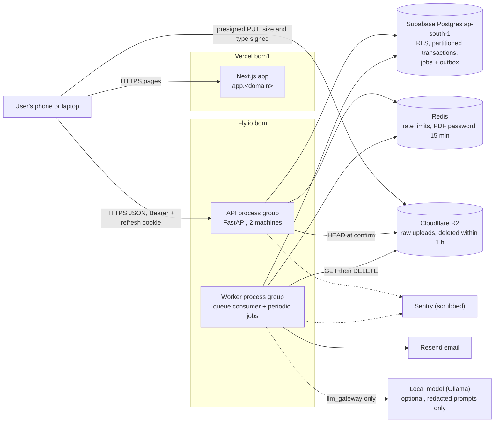
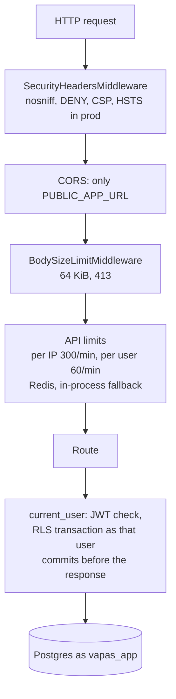
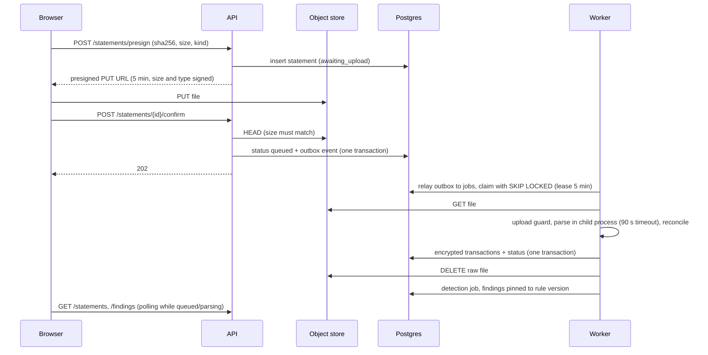

# Architecture (as built)

This page describes what exists in the code. The full design with estimation, trade-offs and the scaling path is `docs/system_design.md`; decisions are in `docs/adr/` and `docs/decisions_log.md`.

## Deployment

## Request path inside the API

## Statement processing

## Modules

| Module | Responsibility |
|---|---|
| `auth/` | Signup, verification, login, refresh rotation, logout, password reset; Argon2id; rate limits |
| `security/` | Envelope encryption, redaction, upload guard, private path guard, API limits, HTTP guards, client IP |
| `db/` | Tables, RLS session setup, repositories |
| `jobs/` | Queue, outbox relay, worker loop, parse/detect handlers, sweeper, case-work tick |
| `ingest/`, `classify/`, `detect/` | Parsing, reconciliation, channel rules, findings |
| `rules/`, `knowledge/` | Verified rule YAML loader, clause search |
| `cases/`, `letters/` | Case state machine, deadlines, template letters with guardrails, evidence PDF, reminders |
| `mail/`, `observability.py` | Email senders (local capture, Resend), Sentry with scrubbing |
| `frontend/` | Next.js app, English and Hindi, mobile-first |

## Built now vs designed only

Built: everything above, plus monthly partitions, RLS on every user-owned table, transactional outbox, dead-letter state, circuit breaker, per-user LLM budget, lifecycle backstop, CI (rules, audit, backend, frontend, full-stack e2e).

Designed only (`docs/system_design.md` section 9): separate worker pools per stage, read replica, Redis Streams or SQS broker, archiving, OpenTelemetry, pgvector, LightGBM channel model.
