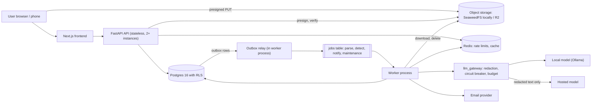
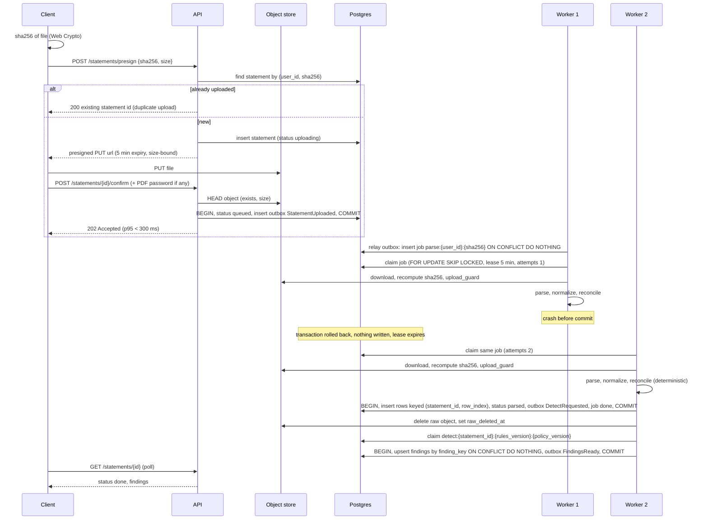

# VAPAS system design

Status: **approved** (M0.5, 19 Nov 2026). All decisions in section 11 were accepted. If code later needs to differ, this document and the matching ADR are updated first.

Numbers marked **[A]** are assumptions. Numbers marked **[A: M3]** are measured in M3 and fed back here. Numbers marked **[U]** are **unvalidated assumptions**: no real statement has been analysed yet, so they are not evidence that late reversals are common. They are checked when the PENDING REAL DATA items in `docs/pending_real_data.md` run.

## 0. Concept map

| Concept | Where it is used in VAPAS |
|---|---|
| Functional vs non-functional requirements | Section 1: what VAPAS does vs the SLO targets it is measured against |
| Back-of-the-envelope estimation | Section 2: sizes the queue, workers, Postgres, object storage, LLM and email |
| SLOs | Section 1.2: upload ack, processing time, availability, raw-file deletion, isolation |
| Modular monolith vs microservices | Section 10, ADR 0002: one codebase with strict modules, one API process type and one worker process type |
| Sync vs async processing | Upload confirm is sync (fast ack); parsing, detection and notification are async jobs |
| Queues and backpressure | Postgres job queue per stage; the month-start spike waits in the queue instead of overloading the API |
| Idempotency | Statement key = (user_id, content sha256); deterministic transaction and finding keys; jobs keyed by idempotency key |
| Transactional outbox | Statement row and its "uploaded" event are committed in one transaction (ADR 0001) |
| Caching | Redis for rules (keyed by rules version) and dashboard summaries; never statement contents |
| Rate limiting | Redis token buckets per user and per IP; per-user daily LLM budget |
| Partitioning | `transactions` range-partitioned by month of `txn_date` (ADR 0006) |
| Circuit breakers | `llm_gateway` around each model provider; email sender |

## 1. Requirements

### 1.1 Functional

1. Account: sign up with email and password, verify email, log in, refresh session, log out, export all data as JSON (profile, consents, statements metadata, transactions still retained, findings with their snapshots, cases, case events, letters), delete account and all data (including object storage).
2. Consent: show a versioned consent notice (English and Hindi), record acceptance with timestamp and version, allow withdrawal.
3. Upload: upload a statement PDF (optionally password-protected), CSV or XLS through a presigned URL; detect duplicate uploads; show processing status.
4. Parse: extract rows into one normalized schema; reconcile the running balance row by row; flag statements that do not reconcile; fall back to the LLM gateway for unknown layouts.
5. Classify: assign a channel (UPI, IMPS, NEFT, RTGS, ATM, POS, ECOM, NACH, AePS, charges) and extract UTR/RRN/reference numbers; separate merchant refunds.
6. Detect: late reversals on claim rows (1a, 2b, 2c, 4b, 5a) against the verified rule in force on the transaction date; unreversed debits that look failed; credit-push rows as worth_checking with letter_scope reversal_only; duplicates; verified charges; NACH 7(b) after user input; compensation already credited. Apply the claim lookback (P2) and the day-type override needs_review rule.
7. Explain: every finding has a level, a plain-language reason, the rule citation, the rule version and the policy version that produced it.
8. User input: confirm/deny a finding, confirm a payment failed, enter a NACH revocation date and confirm proof.
9. Cases: group findings into a case, generate a bank complaint letter from templates (English/Hindi), optional wording polish, guardrails, user approval, evidence pack PDF, case state machine with append-only timeline, RB-IOS 2026 wait and 90-day filing deadline per case, Clause 10 hard blocks before escalation, reminders by email and in-app.
10. Knowledge: clause-level full-text search over the verified instruments, always returning a citation or "not found".
11. Pilot: invite codes, per-finding feedback, weekly impact report without PII.

VAPAS never connects to a bank, never moves money, never submits anything on the user's behalf.

### 1.2 Non-functional targets (SLOs)

| Target | Value | How it is measured |
|---|---|---|
| Availability (API + frontend) | 99.5% per month (about 3.6 h downtime budget per 30 days) | Uptime check on `/health` and the landing page |
| Upload acknowledgement | p95 < 300 ms | API latency of `POST /statements/{id}/confirm` |
| Statement fully processed | p95 < 2 min from confirm to findings ready | `findings_ready_at - confirmed_at` per statement |
| Cross-user data leaks | zero | RLS on every user table, RLS isolation tests in CI, chaos/pen checks in M9 |
| Raw file deletion | within 1 hour of upload | `raw_deleted_at - uploaded_at` per statement, sweeper alert if any object is older than 50 min |
| Deadline reminders | sent on the due day, or an in-app banner if email fails | reminders table `sent_at` vs `due_on` |

Accepted clarification (section 11, item 1): the 2-minute processing SLO applies to statements handled by a deterministic parser. Statements that need the LLM fallback get a separate target (p95 < 10 min) and are reported separately, because a local model on a small GPU cannot meet 2 minutes for a 15-page statement in the worst case (section 2.6).

## 2. Estimation

Inputs given: 100,000 users, 2 statements per user per month, about 15 pages and 400 rows per statement, month-start spike of 10x the average.

### 2.1 Upload rate

- Statements per month: 100,000 x 2 = **200,000**.
- Seconds per month: 30 x 86,400 = 2,592,000.
- Average: 200,000 / 2,592,000 = **0.077 uploads/s** (about 278 per hour).
- Month-start peak: 10 x 0.077 = **0.77 uploads/s** (about 2,780 per hour).
- Design target: **1 upload/s sustained, bursts of 5/s** absorbed by the queue.
- Cross-check with a different spike model [A]: 30% of the month's uploads in the first 3 days, all in 12 waking hours, peak hour 2x: 60,000 / (3 x 12 x 3,600) x 2 = 0.93/s. Same order, so 1/s holds.
- API requests per upload [A]: presign, confirm, about 5 status polls, 3 page loads = about 10. Peak about 8 req/s from uploads; with browsing, design for **50 req/s**. Two small stateless API instances are enough; the second exists for availability, not load.

### 2.2 Rows

- Rows per month: 200,000 x 400 = **80 million**.
- Insert rate at peak: 0.77 x 400 = **about 310 rows/s**. Batched inserts (COPY or executemany) handle this easily on one Postgres primary.

### 2.3 Transactions table size after 2 years

Row size estimate (bytes) [A]:

| Part | Bytes |
|---|---|
| Tuple header + line pointer | 28 |
| id (bigint), user_id (uuid), statement_id (uuid), row_index (int) | 8 + 16 + 16 + 4 = 44 |
| txn_date, value_date (date) | 8 |
| direction, channel (smallint) | 4 |
| amount_paise, balance_paise (bigint) | 16 |
| ref_hmac (16-byte blind index) | 17 |
| ref_enc (about 16 chars + 12 nonce + 16 tag + header) | 48 |
| narration_enc (about 60 chars + 12 nonce + 16 tag + header) | 94 |
| Alignment, padding, fill factor | about 15 |
| **Heap total** | **about 270** |

Indexes per row [A]: primary key (txn_date, id) about 32, (user_id, txn_date) about 36, unique (statement_id, row_index, txn_date) about 40, partial (user_id, ref_hmac) on about 70% of rows about 32. **Index total about 140.**

Total about **410 bytes per row**.

- After 24 months without retention: 80M x 24 = 1.92 billion rows x 410 B = **about 790 GB**.
- One monthly partition: 80M x 410 B = **about 33 GB**.
- With the proposed retention (section 11, item 4: drop transaction partitions older than 13 months; findings keep their own snapshot): 80M x 13 = 1.04 billion rows x 410 B = **about 430 GB**, flat after month 13.

Note: 2 statements per user per month with 400 rows each is a heavy-user assumption. Real usage is more likely one 12-month statement at sign-up and occasional uploads after. The numbers above are an upper bound.

### 2.4 Object storage at any moment

- Average statement file size [A]: 1 MB (15 text pages; scanned PDFs are larger and are rejected or flagged in v1).
- Raw files live at most 1 hour.
- Average resident: 0.077/s x 3,600 s x 1 MB = **about 0.28 GB**.
- Month-start peak resident: 0.77/s x 3,600 s x 1 MB = **about 2.8 GB**.
- Worst case if the sweeper is down for a full day at peak (lifecycle rule as backstop): 0.77 x 86,400 = 66,700 files = **about 67 GB**.
- Evidence packs are generated on demand and streamed, not stored.

### 2.5 Findings [U]

Unvalidated assumptions (no real statement has been analysed; demand for late-reversal claims is not yet proven):

- Statements with at least one claim: **20%** [U].
- Claim findings per statement: **0.25** [U]. Worth-checking findings per statement: **1.0** [U].
- Findings per month: 200,000 x 1.25 = 250,000 rows. Negligible for storage at any realistic rate.
- Cases per day: 6,667 statements/day x 20% [U] x 50% of users who open a case [U] = **about 670 cases/day** [U].
- These rates only size findings, cases, letters and reminders, which are small next to transactions. If the real rate is 10 times lower, no infrastructure number in this document changes; only the product value does.

### 2.6 LLM fallback calls per day and cost

Assumptions:
- Share of statements in an unknown layout (needs fallback) [A: M3]: **5%**.
- Statements per day: 200,000 / 30 = 6,667 average; month-start day 10x = 66,670.
- Fallback statements per day: **333** average, **3,333** on a peak day.
- Per page: about 1,200 input tokens and about 1,800 output tokens (27 rows as JSON) [A].
- Local model output speed on one small GPU (qwen2.5:3b class) [A: M3, measure on the RTX 3050]: **40 tokens/s** per stream.

Option 1, page-by-page extraction (worst case):
- 15 calls per statement: **5,000 calls/day** average, **50,000** on a peak day.
- Output per statement: 15 x 1,800 = 27,000 tokens, which is 675 s (about 11 min) per statement on one stream. **This misses the 2-minute SLO.**
- GPU time: 333 x 675 s = 62 GPU-hours/day average.

Option 2, layout mapping first (built in M3; page-by-page extraction for pages that fail reconciliation is not built yet and is added only if real statements show it is needed):
- One call reads the first page and returns a column mapping (which column is date, narration, debit, credit, balance; the date format; and the header rows to skip): about 1,500 input and 200 output tokens. pdfplumber then extracts every page deterministically using that mapping. Only pages that fail balance reconciliation go to page-by-page extraction (assume 10% of pages, so 1.5 pages per statement).
- About 2.5 calls per statement: **about 830 calls/day** average, **about 8,300** on a peak day.
- Output per statement: 200 + 1.5 x 1,800 = 2,900 tokens, which is about 73 s. This fits inside 2 minutes on most statements.
- GPU time: 333 x 73 s = **about 6.7 GPU-hours/day** average, so one GPU is enough on normal days (about 28% busy). On a peak day it needs about 67 GPU-hours, so either 3 to 4 GPUs during peak hours or a slower fallback queue (see section 11, item 1).
- Cost: statement text must stay on the local model (it is not redacted), so the cost is GPU rental. At an assumed **USD 0.50 per GPU-hour** [A: check provider prices before M9], one always-on GPU costs about USD 12/day (about USD 360/month). Peak days add about USD 20 each.

Hosted model (letter wording polish only, redacted input):
- About 670 cases/day x 1.5 letters x about 1,600 tokens = **about 1.6 million tokens/day**.
- Cost = tokens x the provider's price per token. That price is taken from the provider's own pricing page when the provider is chosen in M7, not from this document. At small-model price levels it is in the range of a few USD per day [A].

### 2.7 Workers

- CPU per statement on the deterministic path [A: M3]: pdfplumber about 0.4 s/page x 15 = 6 s, plus classify, detect and DB writes about 2 s, so **about 8 s**.
- Measured in M3 (`docs/parser_eval.md`): 0.10 s per page for synthetic text PDFs on the development laptop, a quarter of the assumption above. Real bank PDFs may be slower (more words, rulings, fonts); the private-statement evaluation re-measures this (PENDING REAL DATA). The 8 s estimate is kept until then.
- Average load: 0.077/s x 8 s = 0.62 busy processes. **1 to 2 worker processes.**
- Peak load: 0.77/s x 8 s = 6.2 busy processes. At a 70% utilisation target: 6.2 / 0.7 = 8.9, so **10 worker processes** (for example 3 machines with 4 vCPU each) at month start.
- Little's law check at peak: statements in flight = arrival rate x time in system = 0.77 x about 10 s = about 8. Queue wait stays in seconds while utilisation is under about 80%, well inside the 2-minute SLO.
- Postgres connections: 10 workers + 4 API instances x pool 10 = about 50. Fine without PgBouncer at this scale.

### 2.8 Email

- Deadline reminders: about 670 cases/day x 4 reminders (escalation eligible, 30, 7 and 1 days left) = **about 2,700/day** in steady state.
- Verification and password reset [A]: about 1,000/day.
- Total about **3,700/day**. That is beyond typical free tiers at 100k users, so a paid tier is needed at that scale (check current limits when choosing Resend or Brevo in M2). "Statement processed" is an in-app notification, not an email, so it never competes with deadline reminders.

### 2.9 Summary

| Quantity | Average | Peak / cap |
|---|---|---|
| Uploads/s | 0.077 | 0.77 (design 1, bursts of 5) |
| Rows/month | 80M | 310 rows/s insert at peak |
| Transactions table | 33 GB per month | 790 GB at 2 years, 430 GB with 13-month retention |
| Object storage | 0.28 GB | 2.8 GB (67 GB if the sweeper is down for a day) |
| LLM calls/day (mapping mode) | 830 | 8,300 |
| Worker processes | 1 to 2 | 10 |
| Emails/day | 3,700 | deadline reminders first |

## 3. High-level design

Pipeline: upload, then presigned URL, then object store, then outbox event, then parse queue, then worker (guard, parse, normalize, reconcile, delete raw), then detect queue (classify, match, detect, findings), then notify queue (in-app notification; email only for deadline reminders and account mail).

`llm_gateway` is the only module allowed to import a model client. A CI test fails if any other module imports `litellm`, `ollama` or calls a model host.

## 4. Upload and processing sequence (with a worker crash)

Idempotency rules:
- Statement identity is `(user_id, content_sha256)`, unique in the database. The worker recomputes the hash from the stored object and rejects the statement if it differs from what the client sent.
- Job idempotency key: `parse:{user_id}:{content_sha256}`, `detect:{statement_id}:{rules_version}:{policy_version}`, `notify:{event_id}`. A unique index makes a second enqueue a no-op.
- Each stage writes its output, its job state and its next outbox event in one transaction. A crash before commit leaves no partial state. A crash after commit but before deleting the raw file is covered by the sweeper.
- Transaction rows are keyed by `(statement_id, row_index)`. Findings are keyed by `finding_key = sha256(rule_id, rule_version, policy_version, debit txn key, reversal txn key)`. Re-running a stage on the same input produces byte-identical rows and findings. A golden test in M5 proves it.
- A crash after the commit and before the raw-file delete leaves the file to the sweeper (every 5 minutes, deletes raw objects older than 50 minutes). Object store lifecycle rules work in whole days, so the lifecycle rule is a backstop only, not the 1-hour guarantee.

PDF passwords: the confirm call carries the password. It is encrypted with the user's data key and put in Redis under `pdfpw:{statement_id}` with a 15-minute TTL. Redis runs with persistence turned off. The worker reads it once and deletes it. If it is missing (TTL passed, Redis restarted), the statement goes to `needs_password` and the user re-enters it. It is never written to Postgres, logs or object storage. If a worker crashes after reading (and deleting) the password, the retried job finds no password and the statement goes to `needs_password`; the user is asked for it again. See section 11, item 2.

## 5. Data model

Conventions: ids are UUIDs except high-volume tables (bigint). Money is integer paise. All timestamps are `timestamptz` in UTC; legal dates (T, R, deadlines) are `date` in IST, as the annex counts calendar dates.

### 5.1 Database roles and RLS

- `vapas_owner`: owns the schema and runs Alembic migrations. It is the only role allowed to bypass RLS and is never used by the app.
- `vapas_app`: used by the API. `FORCE ROW LEVEL SECURITY` is set on every user-owned table.
- `vapas_worker`: used by the worker. RLS also applies; the worker sets the user context from the job before touching user data.
- Roles are created by a separate step (`infra/postgres/roles.sql`, run by the `db-roles` service locally and by the runbook in production) with passwords from the environment. Migrations only grant privileges; they never hold passwords.
- Per request or job: `SET LOCAL app.user_id = '<uuid>'` inside the transaction (`set_config('app.user_id', ..., true)`), so a pooled connection never carries one user's context into the next transaction.
- Standard policy, called **owner** below: `USING (user_id = NULLIF(current_setting('app.user_id', true), '')::uuid) WITH CHECK (same)`. If the context is not set, it matches no rows (fail closed).
- Cross-user scans (reminders due, outbox relay, partition maintenance) go through `SECURITY DEFINER` functions that return only ids and dates, never contents. Login, refresh-token and email-link lookups happen before a user is known, so they go through narrow `SECURITY DEFINER` functions (`auth_lookup(email)`, `session_lookup(token_hash)`, `email_token_lookup(token_hash, purpose)`) with a fixed `search_path`.
- Access tokens are short-lived JWTs (15 min) carrying the user id and session id. Every authenticated request opens a transaction as that user and checks the session is still active, so logout and refresh-token reuse take effect immediately.

### 5.2 Tables

| Table | Key columns | Indexes (query served) | RLS |
|---|---|---|---|
| `users` | id uuid PK, email citext, password_hash, email_verified_at, locale, password_changed_at, created_at | unique(email) (login via `auth_lookup`) | `id = app.user_id` |
| `user_keys` | user_id PK, wrapped_dek bytea, kek_version int, created_at | PK (load data key per request/job) | owner |
| `sessions` | id, user_id, family_id, refresh_token_hash, expires_at, revoked_at, replaced_by | unique(refresh_token_hash) (refresh via `session_lookup`); (user_id) where revoked_at is null (list or revoke sessions) | owner |
| `email_tokens` | id, user_id, purpose (verify_email, reset_password), token_hash, expires_at, used_at | unique(token_hash) (link lookup via `email_token_lookup`); (user_id, purpose) | owner |
| `consent_notices` | version PK, text_en, text_hi, sha256, published_at | PK | none: global, read-only for app |
| `consents` | id, user_id, notice_version FK, purpose, granted_at, withdrawn_at | (user_id, purpose) (check current consent before processing) | owner |
| `audit_log` | id bigint, user_id null, actor, action, entity_type, entity_id, at, ip_hash | (user_id, at) (data export, investigations) | owner for SELECT; app may INSERT only; no UPDATE/DELETE grants |
| `statements` | id uuid, user_id, content_sha256, bank_code, period_from, period_to, status, object_key, parser_name, parser_version, rows_parsed, reconciled, confirmed_at, findings_ready_at, raw_deleted_at, created_at | unique(user_id, content_sha256) (dedupe, idempotency); (user_id, created_at desc) (statement list); (raw_deleted_at) where null (sweeper) | owner |
| `transactions` (partitioned) | id bigint, txn_date, user_id, statement_id, row_index, value_date, direction, amount_paise, balance_paise, channel, kind (payment, receipt, reversal, merchant_refund, chargeback, compensation, charge, interest), classifier_version, ref_hmac, ref_enc, ext_ref_hmac, ext_ref_enc (UTR/RRN extracted from the narration), narration_enc | PK (id, txn_date); unique(statement_id, row_index, txn_date) (idempotent insert, statement view); (user_id, txn_date) (matching window per user, prunes partitions); (user_id, ref_hmac) and (user_id, ext_ref_hmac) where not null (match by UTR/RRN; both use one blind-index context so the reference column and the narration reference match each other) | owner (policy on the parent; no grants on partitions directly) |
| `rule_versions` | id, rules_sha256, policy_sha256, legal_content, policy_content, loaded_at (inserted by the worker the first time it runs detection with a rule set) | unique(rules_sha256, policy_sha256) | none: global, read-only |
| `rules` | rule_version_id, rule_id, kind, verification, effective_from, effective_to, legal jsonb, policy jsonb | PK(rule_version_id, rule_id); (rule_id, effective_from) (rule in force on T) | none: global, read-only |
| `findings` | id uuid, user_id, finding_key (sha256 of detector, rule, rules and policy hashes, debit and reversal keys), detector, level (claim, worth_checking, needs_user_input, needs_review, historical, informational), confidence, status, rule_id, rule_version_id, policy_version, detector_version, finding_policy, letter_scope, question, group_key, statement_id, debit_txn (id, date), t_date, r_date, delay_days, amount_owed_paise, already_paid_paise, accruing, why, snapshot_enc, superseded_at | unique(user_id, finding_key) (idempotent upsert); (user_id, level, created_at desc) where not superseded (dashboard). No foreign key to `transactions`, so dropping old partitions never blocks; the encrypted snapshot keeps the facts. Database checks: amounts only on claim or informational findings, never with letter_scope reversal_only | owner; app may update status only |
| `user_inputs` | id, user_id, question (payee_was_merchant, payment_failed, mandate_revoked), subject (debit key or mandate group key), answer jsonb, entered_at | unique(user_id, question, subject); answers survive re-detection because they point at transactions or mandate groups, not at findings | owner |
| `finding_feedback` | finding_id, user_id, verdict, at | PK(finding_id, user_id) | owner |
| `cases` | id uuid, user_id, state, bank_code, bank_received_on, wait_days_applied, escalation_eligible_on, bank_last_communication_on, filing_deadline_on, deadline_rule_version_id, created_at | (user_id, created_at desc) (case list); (state, filing_deadline_on) (expiry scan via definer function) | owner |
| `case_findings` | case_id, finding_id, user_id | PK(case_id, finding_id); unique(finding_id) (one finding in one case) | owner |
| `case_events` | id bigint, case_id, user_id, seq, type, payload jsonb, at | unique(case_id, seq) (ordered timeline) | owner; INSERT and SELECT only, no UPDATE/DELETE grants (append-only) |
| `letters` | id, case_id, user_id, kind (bank, cms), lang, template_version, body_enc, polished, guardrail_result, approved_at | (case_id) | owner |
| `reminders` | id, case_id, user_id, kind (eligible, d30, d7, d1), due_on, sent_at, attempts, channel | unique(case_id, kind); (due_on) where sent_at is null (due scan via definer function) | owner |
| `notifications` | id, user_id, kind, ref_id, created_at, read_at | (user_id, read_at) (in-app banner, unread count) | owner |
| `jobs` | id bigint, queue, idempotency_key, user_id, payload jsonb (ids only), state, attempts, max_attempts, run_after, locked_by, locked_until, last_error_code, created_at | unique(idempotency_key); (queue, run_after) where state = 'queued' (claim next job); (locked_until) where state = 'running' (expired lease scan) | none; worker role only, app cannot read; payload never holds PII |
| `outbox` | id bigint, event_type, aggregate_id, payload jsonb (ids only), created_at, published_at | (id) where published_at is null (relay) | none; app may INSERT only |
| `llm_usage` | user_id, day, calls, tokens | PK(user_id, day) (daily budget check) | owner |
| `circular_clauses` | id, instrument_id, clause, text, url, tsv tsvector generated | GIN(tsv) (full-text search); (instrument_id, clause) | none: global, read-only |
| `analytics_events` | id bigint, event_type, props jsonb (no user id, no statement id, no narration; for example `statement_analysed`: bank_code, rows, questions_total, questions_by_type, findings_by_level), at | (event_type, at) (weekly impact report) | none; worker may INSERT only; reports run as owner |
| `invites` | code PK, created_at, used_by, used_at | PK | none; checked via definer function |

### 5.3 Transactions partitioning (built now)

- `PARTITION BY RANGE (txn_date)`, one partition per calendar month. Primary and unique keys include `txn_date`, as Postgres requires.
- The worker creates the partition for each month a statement touches, inside the same transaction that inserts the rows, through the `ensure_transaction_partition(month)` function (owner rights, advisory lock, idempotent). There is deliberately **no DEFAULT partition**: a row in a DEFAULT partition blocks creating the matching monthly partition later, so a missing partition must fail loudly instead (changed in M3).
- Queries filter on `user_id` and a `txn_date` range, so partition pruning applies (matching only looks at debit date + 30 days).
- Retention is a `DROP` of an old partition (instant, no vacuum storm), not a large `DELETE`. See section 11, item 4.
- Findings reference transactions by `(id, txn_date)` and also store an encrypted, masked snapshot (`snapshot_enc`), so a finding and its case evidence survive after the transaction partition is dropped.

### 5.4 Findings and rule versions

- Rule YAML from `rules/` is loaded into `rule_versions` / `rules` at deploy by `rules/loader.py`. `rules_sha256` covers the legal fields; `policy_sha256` covers the product-policy fields and policy config such as `CLAIM_LOOKBACK_MONTHS` (ADR 0004, ADR 0009).
- A finding stores `rule_id`, `rule_version_id`, `policy_version`, `finding_policy` and `letter_scope` at creation. It is never re-pointed to a newer rule. When the rules change, the next detection run creates new findings under the new version; old findings stay as history.
- Only rules with `verification = verified` can produce a finding with an amount. The loader refuses to activate a rule version in which a claim-producing rule is not verified.

### 5.5 Case timeline and deadline

- `case_events` is append-only and the source of truth. `cases` holds the current state and the derived dates for fast queries. Both are updated in the same transaction.
- On `sent_to_bank`: `escalation_eligible_on = bank_received_on + max(30, escalation_wait_days of the rule)` (P3).
- `filing_deadline_on = max(escalation_eligible_on, bank_last_communication_on) + 90 days` (`rbi.rbios26.deadline`). It is recomputed (with a new event) whenever the user enters or changes the bank's last communication date. `deadline_rule_version_id` records which rule version produced it.
- A daily maintenance job moves cases past `filing_deadline_on` to `expired` and logs an event.

## 6. Caching and rate limiting

### 6.1 Caching (Redis)

| What | Key | TTL | Invalidation |
|---|---|---|---|
| Active rules and policy | `rules:{rules_sha256}:{policy_sha256}` | 1 h | A new version is a new key; the pointer `rules:active` is replaced at deploy. Workers and API read the pointer at the start of each job/request, so a rule change never mixes versions inside one detection run. |
| Dashboard summary per user (counts, totals) | `dash:{user_id}` | 60 s | Deleted after commit of any finding, case or feedback write for that user |
| Clause search results | `kb:{rules_sha256}:{query_hash}` | 24 h | Key includes the rules version |
| Encrypted PDF password | `pdfpw:{statement_id}` | 15 min | Deleted on first read |

Never cached: transaction rows, narrations, letters, account numbers, presigned URLs. Redis runs with persistence turned off; losing it loses only cache, rate-limit state and pending PDF passwords.

### 6.2 Rate limiting (token bucket in Redis)

| Scope | Bucket | Why these numbers |
|---|---|---|
| Upload presign, per user | capacity 15, refill 15 per day | Normal use is 2 per month; onboarding with 12 monthly statements plus retries fits in one day; a scripted abuser is capped at 15 parses per day |
| LLM fallback, per user | 2 fallback statements per day (`llm_usage`) | One fallback statement costs about 73 s of GPU time; 2 per day per user keeps a single abusive account under 1% of daily GPU capacity |
| Login, per account | 5 failures per 15 min, then exponential backoff | Slows password guessing on one account without a lockout that an attacker could trigger on purpose |
| Login and signup, per IP | capacity 20, refill 20 per 10 min | Indian mobile networks put many users behind one carrier NAT IP, so per-IP limits stay loose and per-account limits do the real work |
| Password reset and verification email, per account | 3 per hour | Stops email bombing and protects the email quota for deadline reminders |
| General API, per user | capacity 120, refill 60 per min | A finding review session is about 1 request per second at most |
| General API, per IP | capacity 600, refill 300 per min | Carrier NAT again; only stops floods |

If Redis is down: auth routes fail closed (HTTP 503 with a retry message); the general API falls back to an in-process limiter per instance (less precise, still bounded).

## 7. Failure modes

| Failure | Detection | Impact | Behaviour |
|---|---|---|---|
| Postgres down | Health check fails, connection errors, Sentry alert | Whole app unavailable; counts against the 99.5% budget | API returns 503 with a friendly page; workers stop claiming and retry with backoff; nothing is lost because uploads already in object storage are re-confirmed by the client on retry; managed Postgres with point-in-time recovery |
| Redis down | Health check, connection errors | No cache, no shared rate limits, pending PDF passwords lost | Reads go straight to Postgres; auth fails closed, other routes use in-process limits; statements waiting on a lost password go to `needs_password` |
| Object store down | Presign/HEAD/GET errors, health check | New uploads blocked; parsing stalls | Upload page shows "try again later"; parse jobs retry with backoff; nothing in Postgres changes until a file is readable; the sweeper retries deletes so the 1-hour deletion SLO is reported as breached, not hidden |
| LLM provider down (hosted) | Circuit breaker opens after N failures in a window | Letter polishing unavailable | Gateway skips polishing and the unpolished template letter is used (it is already complete and correct) |
| Local model down | Circuit breaker, health ping | Unknown-layout statements cannot be parsed | Statement goes to `needs_review` with "we cannot read this layout yet"; job retries on a slow schedule; known layouts are unaffected |
| Email provider down | Send errors, circuit breaker | Reminders delayed; deadline-critical | Retries with backoff for up to 24 h; an in-app banner is shown immediately for every due reminder regardless of email; a reminder still unsent 24 h after its due date raises an alert; the d1 reminder is due early enough that the user can still file |
| Poison statement (crashes or times out the parser) | attempts reaches max_attempts (3) | One statement fails | Job goes to `dead`; statement status `failed` with a re-upload suggestion; raw file deleted on schedule; dead-letter count alert; synthetic regression test added once the cause is known |
| Parser hangs (pathological PDF) | Parse runs in a child process with a timeout (90 s) | One statement delayed | Child process is killed; job retried with backoff; after 3 attempts it goes to `dead` and the statement to `failed` |
| Queue backlog older than the raw-file limit | Sweeper deletes raw files older than 50 minutes regardless of state | Statement cannot be parsed | Parse finds the file missing and marks the statement `failed` (`file_missing`); the user re-uploads. Deletion within 1 hour wins over completing a delayed parse |
| Worker crash after reading the PDF password | Retried job finds no `pdfpw:{statement_id}` key | One password-protected statement waits for the user | Statement status `needs_password`; in-app notification asks the user to enter the password again; the job resumes from parse |
| Duplicate upload | unique(user_id, content_sha256) | None | Presign returns the existing statement; no second parse |
| Worker crash mid-statement | Lease (`locked_until`) expires | Statement delayed by up to the lease (5 min) | Another worker reclaims; stage transaction was not committed, so the redo is clean (section 4) |
| Outbox relay stuck | Oldest unpublished outbox row age > 1 min | New statements wait | Relay runs in every worker process with `SKIP LOCKED`, so one stuck relay does not block the others; alert on age |
| Rule YAML invalid at deploy | Loader validation in CI and at startup | Deploy blocked | Old rule version stays active; nothing switches to a partial rule set |

## 8. Security architecture

- **RLS**: section 5.1. Every user-owned table has `FORCE ROW LEVEL SECURITY` with the owner policy. CI runs isolation tests that log in as user A and try to read user B's rows through every table with raw SQL through the app role (M2).
- **Envelope encryption** (implemented in `security/crypto.py`, details and rotation plan in `docs/privacy.md`): each user has a random 256-bit data key (DEK). It is stored only wrapped (AES-GCM) by a master key (KEK) from the environment, with `kek_version` for rotation. Encrypted fields: narration, reference numbers, finding snapshots, letter bodies, account numbers. Masked last 4 digits are stored in plain text where the UI needs them. Equality lookups on reference numbers use a per-user keyed HMAC (`ref_hmac`), so matching by UTR works without decrypting. Deleting a user's DEK makes any copy left in backups unreadable (crypto-shredding), which supports the right to erase. KEK rotation re-wraps DEKs only; data is not re-encrypted.
- **Redaction boundary**: `llm_gateway` is the only path to any model. Every prompt (both routes, from M3) is redacted (account and card numbers, phone numbers, emails, PAN, UPI IDs, IFSC codes, long digit runs, masked account numbers) and then scanned again; the call is blocked if anything matching those patterns remains. For the layout-mapping fallback the prompt is a *sketch*: only the line directly above the first dated row (the column header) plus up to 8 dated rows with every letter replaced by `x` (month names and Cr/Dr kept). Residual risk: a header line that itself contains a name would be sent after regex redaction; header lines are column labels in every layout seen so far.
- **Presigned URLs**: upload URLs expire in 5 minutes, are bound to a content length range and to the key `raw/{user_id}/{statement_id}`; there are no download URLs for raw files (only the worker reads them). The bucket is private, without public access or listing.
- **Upload guard**: runs in the worker: size limit, PDF magic bytes, page limit, rejects JavaScript, embedded files and launch actions, timeouts per page.
- **Secrets**: only from the environment via pydantic-settings; `.env` is gitignored; hosts hold production secrets. No secret ever reaches logs or Sentry (Sentry before-send scrubber).
- **Audit log**: logins, consent changes, data export, deletion, case state changes, letter approvals. Append-only (no UPDATE/DELETE grants). No narrations or amounts in it.
- **Logs**: structured JSON with ids only. A test fails if a log record contains anything matching the redaction patterns.
- **Private fixtures guard**: `security/private_path_guard.py` resolves `PRIVATE_FIXTURES_DIR` (following symlinks and junctions) and refuses to start if it is inside the repository. Every script that reads real statements calls it first, and CI tests that a path inside the repo fails.

## 9. Scaling path

| Area | 1k users | 100k users (target) | 1M users |
|---|---|---|---|
| API | 1 instance (2 for availability) | 2 to 4 instances | Autoscaled; PgBouncer in front of Postgres |
| Workers | 1 process, all queues | Same code, 2 to 10 processes, scaled for the month-start spike | Separate worker pools per stage (parse is CPU, LLM fallback is GPU, notify is IO) |
| Queue | Postgres `SKIP LOCKED` + outbox | Same | Outbox relay publishes to Redis Streams or SQS instead of the jobs table; API unchanged |
| Postgres | One small managed instance | One primary, 4 to 8 vCPU, about 430 to 790 GB | Read replica for dashboards and reports; archive old partitions to Parquet in object storage; shard by user_id only if one primary can no longer take the writes |
| Transactions | Partitioned by month | Partition pruning, partition drop for retention | Same plus archiving |
| LLM | Local model on the dev GPU or one cloud GPU | 1 GPU, 3 to 4 at month start | GPU pool sized by fallback share; more native parsers to reduce fallback |
| Email | Free tier | Paid tier | Paid tier, dedicated sending domain |

| Item | Status |
|---|---|
| Postgres queue with outbox, per-stage queues, dead-letter | Built now (M1/M3) |
| One worker process consuming all queues | Built now |
| Transactions partitioning by month | Built now (M1/M3) |
| RLS, envelope encryption, redaction gateway | Built now (M2/M3) |
| Structured logs, Sentry | Built now (M1/M9) |
| Postgres full-text search for clauses | Built now (M6) |
| Separate worker pools per stage | Designed only |
| Read replica | Designed only |
| Redis Streams / SQS broker | Designed only |
| Partition archiving to object storage | Designed only |
| pgvector hybrid search | Only if M6 recall@5 < 0.9 |
| LightGBM channel model | Only if M4 coverage < about 95% |
| OpenTelemetry tracing | Deferred |

## 10. Why a modular monolith with one worker process

- **Team size**: one developer. Microservices multiply deploys, network calls, versioned APIs and failure modes without any team to own them.
- **Data**: almost every operation touches one user's statements, findings and cases together, and RLS works per database session. Splitting the data across services would break single-transaction guarantees (statement + outbox, findings + job state) that the idempotency design depends on.
- **Load**: section 2 shows the whole 100k-user load fits one Postgres primary, a few API instances and up to 10 worker processes.
- **What gives the benefits of services anyway**: strict module boundaries inside `src/vapas/` (only `llm_gateway` talks to models, only `storage` talks to object storage, only `db/repo.py` writes SQL), each module with its own tests; the API and worker are separate process types from the same codebase, so they scale independently.
- **Exit path**: the parts most likely to need separation (LLM fallback on GPU, parse workers) are already behind a queue, so they can move to their own pool or service later without touching the API (section 9).

## 11. Decisions (all accepted 19 Nov 2026)

1. **Processing SLO for fallback statements**: p95 < 2 min for statements handled by a deterministic parser; a separate p95 < 10 min target for LLM-fallback statements, reported separately.
2. **PDF password in Redis**: encrypted with the user's data key, TTL 15 minutes, Redis without persistence, deleted on first read. A worker crash after reading the password puts the statement in `needs_password` and the user is asked again (section 7).
3. **Raw file deletion**: the 1-hour target is met by a sweeper job every 5 minutes; the storage lifecycle rule (day granularity) is only a backstop.
4. **Transaction retention**: drop transaction partitions older than 13 months (12-month claim lookback plus one month of margin); findings and case evidence keep their own encrypted snapshots. Data export includes findings with their snapshots, so a user can still export everything VAPAS found after the underlying transactions are dropped.
5. **LLM fallback mode**: layout mapping first, page-by-page only for pages that fail reconciliation (section 2.6).
6. **Demand not yet validated**: the M0.7 demand check was removed from the plan. Finding rates in section 2.5 are unvalidated assumptions [U]. Real-statement checks (M3 eval_private, M4 coverage, M5 eval_private) are tracked in `docs/pending_real_data.md` and run when real statements are available.
